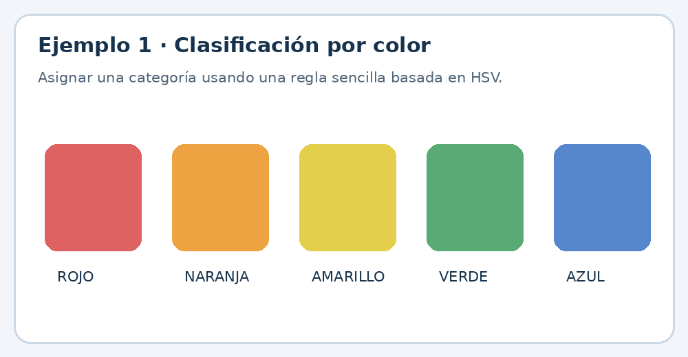
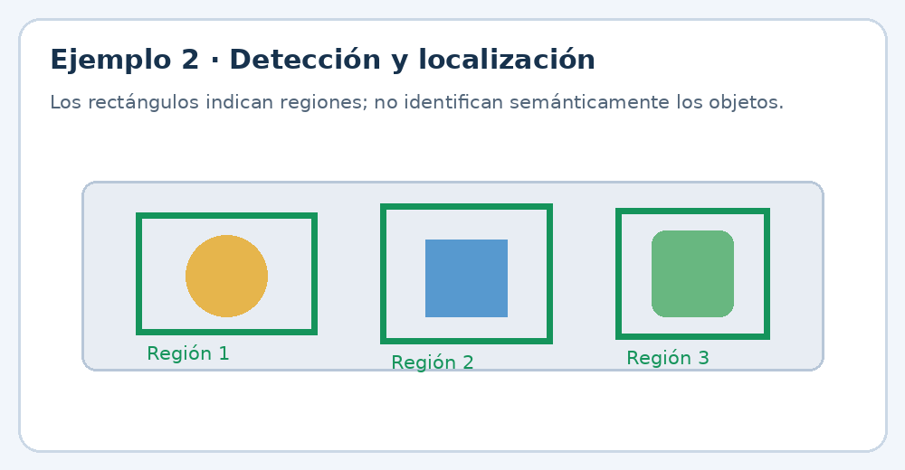
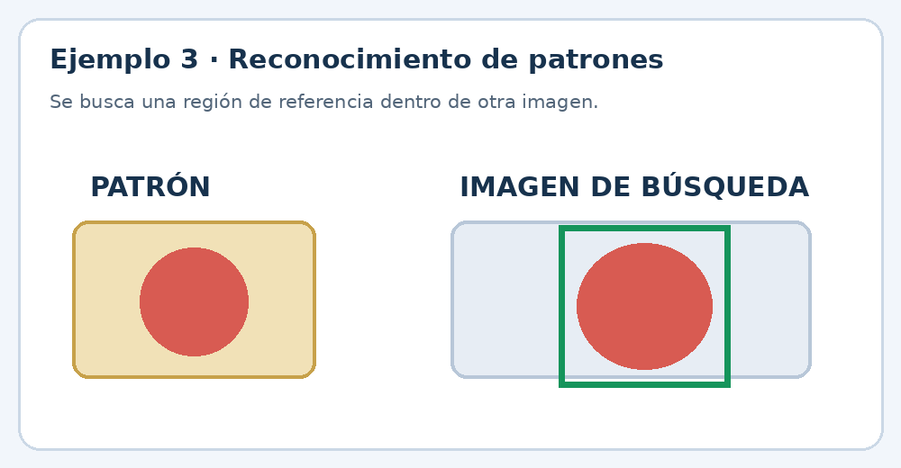
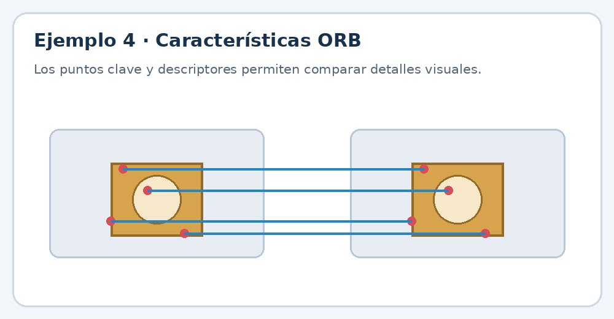

# UIII · Actividad 3. Introducción al reconocimiento de imágenes

> **Práctica demostrativa | Visión Artificial | Tercer semestre**
>
> **Especialidad:** Inteligencia Artificial  
> **Duración:** 2 horas  
> **Herramientas:** Python, Visual Studio Code, OpenCV y NumPy  
> **Nivel:** Cero a principiante

---

## 1. Propósito de la práctica

Que los estudiantes comprendan cuatro tareas fundamentales de la Visión Artificial mediante ejemplos prácticos en Python:

1. **Clasificación de imágenes:** asignar una categoría a una imagen.
2. **Detección y localización de objetos:** identificar regiones y señalar su posición mediante rectángulos.
3. **Reconocimiento de patrones:** localizar una figura o región de referencia dentro de otra imagen.
4. **Identificación de características y similitudes:** comparar puntos clave y descriptores visuales.

Al finalizar, los estudiantes tendrán un proyecto funcional que procesa dos imágenes y genera automáticamente resultados en una carpeta.

## 2. Diferencias entre las cuatro tareas

### Ejemplo 1. Clasificación


Determina a qué categoría pertenece una imagen. En esta práctica se utiliza el color predominante como criterio sencillo.

### Ejemplo 2. Detección y localización


Busca regiones con contornos y dibuja rectángulos para indicar dónde se encuentran.

### Ejemplo 3. Reconocimiento de patrones


Busca una región de referencia dentro de otra fotografía.

### Ejemplo 4. Identificación de características


Compara puntos clave, texturas y características visuales para determinar si dos imágenes tienen similitudes.

> **Nota didáctica:** se utilizan métodos clásicos de OpenCV. La clasificación por color es una clasificación basada en reglas, no un modelo entrenado para reconocer categorías semánticas como perros, gatos o automóviles.

---

## 3. Preparación de las imágenes

Prepara dos fotografías:

- `img_1.jpg`: fotografía de referencia; por ejemplo, una mochila, botella, fruta o juguete.
- `img_2.jpg`: fotografía diferente donde aparezca el mismo objeto, preferentemente en otra posición o con un fondo distinto.

**Recomendaciones:**

- Utiliza imágenes JPG o JPEG.
- Preferentemente, fotografías de al menos 400 × 400 píxeles.
- Evita fotografías oscuras o desenfocadas.
- Para los ejemplos 3 y 4, procura que el mismo objeto aparezca en ambas fotografías.

## 4. Crear el proyecto desde la terminal de VS Code

### Paso 1. Crear la carpeta de trabajo

1. Abre Visual Studio Code.
2. Selecciona **Terminal → New Terminal**.
3. Comprueba que la terminal utilice PowerShell.
4. Ejecuta:

```powershell
mkdir u3-p3-rec-img-0777
cd u3-p3-rec-img-0777
```

- `mkdir`: crea una carpeta.
- `cd`: ingresa a la carpeta creada.

### Paso 2. Crear el entorno virtual

```powershell
python -m venv .env-va-0777
```

- `python`: ejecuta Python.
- `-m venv`: crea un entorno virtual.
- `.env-va-0777`: nombre del entorno virtual.

El entorno virtual permite instalar las librerías necesarias sin afectar otras instalaciones de Python.

### Paso 3. Activar el entorno virtual

```powershell
.\.env-va-0777\Scripts\Activate.ps1
```

Si PowerShell bloquea la activación por la política de ejecución:

```powershell
Set-ExecutionPolicy -Scope Process -ExecutionPolicy Bypass
```

Después vuelve a ejecutar el comando de activación. La terminal deberá mostrar un prefijo parecido a:

```text
(.env-va-0777) PS C:\...\u3-p3-rec-img-0777>
```

### Paso 4. Instalar las librerías

```powershell
python -m pip install --upgrade pip
pip install opencv-python numpy
```

| Librería | Función |
|---|---|
| OpenCV (`cv2`) | Leer, procesar, analizar y guardar imágenes. |
| NumPy (`numpy`) | Trabajar con matrices y arreglos numéricos de imágenes. |

### Paso 5. Crear el archivo de requerimientos

```powershell
pip freeze > requirements.txt
```

Guarda las librerías y sus versiones para reproducir el entorno. Consulta el contenido con:

```powershell
Get-Content requirements.txt
```

### Paso 6. Seleccionar el intérprete de Python

1. Presiona `Ctrl + Shift + P`.
2. Escribe `Python: Select Interpreter`.
3. Selecciona el intérprete del entorno `.env-va-0777`.

---

## 5. Crear la estructura de carpetas y archivos

Ejecuta en la terminal:

```powershell
mkdir img-original-0777
mkdir codigopy-0777
mkdir resultados-img-0777
```

La estructura será:

```text
u3-p3-rec-img-0777/
│
├── .env-va-0777/
│
├── img-original-0777/
│   ├── img_1.jpg
│   └── img_2.jpg
│
├── codigopy-0777/
│   └── p3-rec-img-0777.py
│
├── resultados-img-0777/
│
└── requirements.txt
```

### Paso 7. Agregar las imágenes originales

Copia las fotografías dentro de `img-original-0777/` con estos nombres exactos:

```text
img_1.jpg
img_2.jpg
```

**Importante:** el segundo nombre debe llevar la extensión `.jpg`; no debe escribirse `img_2jpg`.

### Paso 8. Crear el archivo Python

Dentro de `codigopy-0777`, crea:

```text
p3-rec-img-0777.py
```

## 6. Programación de los cuatro ejemplos guiados

Abre `p3-rec-img-0777.py` y copia el siguiente código completo:

```python
# ============================================================
# PRACTICA 3: INTRODUCCION AL RECONOCIMIENTO DE IMAGENES
# Especialidad: Inteligencia Artificial
# Nivel: Tercer semestre de preparatoria
# Archivo: p3-rec-img-0777.py
# ============================================================

import cv2
import numpy as np
import os

# 1. CONFIGURACION DE CARPETAS
CARPETA_IMAGENES = "img-original-0777"
CARPETA_RESULTADOS = "resultados-img-0777"
RUTA_IMG1 = os.path.join(CARPETA_IMAGENES, "img_1.jpg")
RUTA_IMG2 = os.path.join(CARPETA_IMAGENES, "img_2.jpg")
os.makedirs(CARPETA_RESULTADOS, exist_ok=True)

# 2. LEER LAS IMAGENES
img1 = cv2.imread(RUTA_IMG1)
img2 = cv2.imread(RUTA_IMG2)

if img1 is None:
    raise FileNotFoundError("No se pudo abrir img_1.jpg. Revisa la carpeta y el nombre.")
if img2 is None:
    raise FileNotFoundError("No se pudo abrir img_2.jpg. Revisa la carpeta y el nombre.")

print("=" * 55)
print("PRACTICA 3: RECONOCIMIENTO DE IMAGENES")
print("=" * 55)
print("Imagen 1:", img1.shape)
print("Imagen 2:", img2.shape)
reporte = []

# EJEMPLO 1. CLASIFICACION DE IMAGENES POR COLOR
print("\\nEJEMPLO 1: CLASIFICACION POR COLOR")

def clasificar_color(imagen):
    hsv = cv2.cvtColor(imagen, cv2.COLOR_BGR2HSV)
    saturacion = np.mean(hsv[:, :, 1])
    tono = np.mean(hsv[:, :, 0])

    if saturacion < 35:
        categoria = "Imagen con poco color"
    elif tono < 10 or tono >= 170:
        categoria = "Predominio rojo"
    elif tono < 25:
        categoria = "Predominio naranja"
    elif tono < 35:
        categoria = "Predominio amarillo"
    elif tono < 85:
        categoria = "Predominio verde"
    elif tono < 100:
        categoria = "Predominio cian"
    elif tono < 130:
        categoria = "Predominio azul"
    else:
        categoria = "Predominio violeta"
    return categoria, tono, saturacion

categoria1, tono1, sat1 = clasificar_color(img1)
categoria2, tono2, sat2 = clasificar_color(img2)
resultado1 = img1.copy()
resultado2 = img2.copy()

cv2.putText(resultado1, categoria1, (15, 35), cv2.FONT_HERSHEY_SIMPLEX, 0.7, (0,255,0), 2)
cv2.putText(resultado2, categoria2, (15, 35), cv2.FONT_HERSHEY_SIMPLEX, 0.7, (0,255,0), 2)
cv2.imwrite(os.path.join(CARPETA_RESULTADOS, "ejemplo1_clasificacion_img1.jpg"), resultado1)
cv2.imwrite(os.path.join(CARPETA_RESULTADOS, "ejemplo1_clasificacion_img2.jpg"), resultado2)
print("Imagen 1:", categoria1)
print("Imagen 2:", categoria2)
reporte += ["EJEMPLO 1: CLASIFICACION POR COLOR", "Imagen 1: " + categoria1, "Imagen 2: " + categoria2]

# EJEMPLO 2. DETECCION Y LOCALIZACION DE REGIONES
print("\\nEJEMPLO 2: DETECCION Y LOCALIZACION")

def detectar_regiones(imagen, nombre_salida):
    gris = cv2.cvtColor(imagen, cv2.COLOR_BGR2GRAY)
    suavizada = cv2.GaussianBlur(gris, (5, 5), 0)
    bordes = cv2.Canny(suavizada, 50, 150)
    kernel = np.ones((3, 3), np.uint8)
    bordes = cv2.morphologyEx(bordes, cv2.MORPH_CLOSE, kernel)
    contornos, jerarquia = cv2.findContours(bordes, cv2.RETR_EXTERNAL, cv2.CHAIN_APPROX_SIMPLE)
    resultado = imagen.copy()
    cantidad = 0
    for contorno in contornos:
        area = cv2.contourArea(contorno)
        if area > 500:
            x, y, ancho, alto = cv2.boundingRect(contorno)
            cv2.rectangle(resultado, (x,y), (x+ancho,y+alto), (0,255,0), 2)
            cantidad += 1
            cv2.putText(resultado, "Region " + str(cantidad), (x,max(y-8,20)),
                        cv2.FONT_HERSHEY_SIMPLEX, 0.5, (0,255,0), 1)
    cv2.imwrite(os.path.join(CARPETA_RESULTADOS, nombre_salida), resultado)
    return cantidad

cantidad1 = detectar_regiones(img1, "ejemplo2_deteccion_img1.jpg")
cantidad2 = detectar_regiones(img2, "ejemplo2_deteccion_img2.jpg")
print("Regiones encontradas en imagen 1:", cantidad1)
print("Regiones encontradas en imagen 2:", cantidad2)
reporte += ["\\nEJEMPLO 2: DETECCION Y LOCALIZACION",
            "Regiones en imagen 1: " + str(cantidad1),
            "Regiones en imagen 2: " + str(cantidad2)]

# EJEMPLO 3. RECONOCIMIENTO DE PATRONES
print("\\nEJEMPLO 3: RECONOCIMIENTO DE PATRONES")
gris1 = cv2.cvtColor(img1, cv2.COLOR_BGR2GRAY)
gris2 = cv2.cvtColor(img2, cv2.COLOR_BGR2GRAY)
alto1, ancho1 = gris1.shape
x1, x2 = int(ancho1 * 0.25), int(ancho1 * 0.75)
y1, y2 = int(alto1 * 0.25), int(alto1 * 0.75)
patron = gris1[y1:y2, x1:x2]
alto2, ancho2 = gris2.shape

if patron.shape[0] > alto2 or patron.shape[1] > ancho2:
    escala = min(ancho2 / patron.shape[1], alto2 / patron.shape[0])
    nuevo_ancho = max(1, int(patron.shape[1] * escala))
    nuevo_alto = max(1, int(patron.shape[0] * escala))
    patron = cv2.resize(patron, (nuevo_ancho, nuevo_alto))

coincidencias = cv2.matchTemplate(gris2, patron, cv2.TM_CCOEFF_NORMED)
minimo, maximo, ubicacion_min, ubicacion_max = cv2.minMaxLoc(coincidencias)
x, y = ubicacion_max
alto_patron, ancho_patron = patron.shape
resultado_patron = img2.copy()
cv2.rectangle(resultado_patron, (x,y), (x+ancho_patron,y+alto_patron), (0,255,0), 3)
cv2.putText(resultado_patron, "Coincidencia: " + str(round(maximo*100,2)) + "%",
            (10,30), cv2.FONT_HERSHEY_SIMPLEX, 0.7, (0,255,0), 2)
cv2.imwrite(os.path.join(CARPETA_RESULTADOS, "ejemplo3_reconocimiento_patron.jpg"), resultado_patron)
print("Porcentaje de coincidencia:", round(maximo*100,2), "%")
reporte += ["\\nEJEMPLO 3: RECONOCIMIENTO DE PATRONES",
            "Coincidencia encontrada: " + str(round(maximo*100,2)) + "%"]

# EJEMPLO 4. IDENTIFICACION DE CARACTERISTICAS ORB
print("\\nEJEMPLO 4: IDENTIFICACION DE CARACTERISTICAS")
orb = cv2.ORB_create(nfeatures=1000)
puntos1, descriptores1 = orb.detectAndCompute(gris1, None)
puntos2, descriptores2 = orb.detectAndCompute(gris2, None)

if descriptores1 is not None and descriptores2 is not None:
    comparador = cv2.BFMatcher(cv2.NORM_HAMMING)
    pares = comparador.knnMatch(descriptores1, descriptores2, k=2)
    buenas = []
    for par in pares:
        if len(par) == 2:
            mejor, segundo = par
            if mejor.distance < 0.75 * segundo.distance:
                buenas.append(mejor)
    resultado_orb = cv2.drawMatches(img1, puntos1, img2, puntos2, buenas[:50], None,
                                    flags=cv2.DrawMatchesFlags_NOT_DRAW_SINGLE_POINTS)
    cantidad_buenas = len(buenas)
else:
    resultado_orb = np.zeros((300,600,3), dtype=np.uint8)
    cv2.putText(resultado_orb, "No se encontraron suficientes caracteristicas",
                (10,150), cv2.FONT_HERSHEY_SIMPLEX, 0.6, (255,255,255), 2)
    cantidad_buenas = 0

cv2.imwrite(os.path.join(CARPETA_RESULTADOS, "ejemplo4_caracteristicas_ORB.jpg"), resultado_orb)
print("Puntos clave imagen 1:", len(puntos1))
print("Puntos clave imagen 2:", len(puntos2))
print("Coincidencias filtradas:", cantidad_buenas)
reporte += ["\\nEJEMPLO 4: IDENTIFICACION DE CARACTERISTICAS",
            "Puntos clave imagen 1: " + str(len(puntos1)),
            "Puntos clave imagen 2: " + str(len(puntos2)),
            "Coincidencias filtradas: " + str(cantidad_buenas)]

# GUARDAR REPORTE GENERAL
ruta_reporte = os.path.join(CARPETA_RESULTADOS, "reporte_reconocimiento.txt")
with open(ruta_reporte, "w", encoding="utf-8") as archivo:
    archivo.write("PRACTICA 3: RECONOCIMIENTO DE IMAGENES\\n")
    archivo.write("=" * 50 + "\\n\\n")
    archivo.write("Resultados de los cuatro ejemplos:\\n\\n")
    for linea in reporte:
        archivo.write(linea + "\\n")

print("\\n" + "=" * 55)
print("PROCESAMIENTO TERMINADO CORRECTAMENTE")
print("Revisa la carpeta resultados-img-0777")
print("=" * 55)

```

---

## 7. Explicación paso a paso de cada ejemplo

### Ejemplo 1. Clasificación de imágenes por color

**Objetivo:** analizar una fotografía y asignarle una categoría de acuerdo con su color predominante.

**Procedimiento:**

1. Leer la imagen con `cv2.imread()`.
2. Convertir BGR a HSV.
3. Obtener el promedio del tono y la saturación.
4. Comparar los valores mediante `if`, `elif` y `else`.
5. Asignar una categoría de color.
6. Escribir la categoría sobre la fotografía.
7. Guardar el resultado.

**Comandos principales:**

| Comando | Función |
|---|---|
| `cv2.cvtColor()` | Cambia el espacio de color. |
| `cv2.COLOR_BGR2HSV` | Convierte BGR a HSV. |
| `np.mean()` | Calcula el promedio. |
| `cv2.putText()` | Escribe texto sobre la imagen. |
| `cv2.imwrite()` | Guarda una imagen. |


**Resultado esperado:** dos fotografías con una etiqueta que indica su categoría de color predominante.

> El cálculo utiliza promedios globales de HSV. No determina qué objeto aparece en la fotografía ni identifica su categoría semántica.

### Ejemplo 2. Detección y localización de objetos

**Objetivo:** encontrar regiones de una imagen que tengan contornos y dibujar rectángulos alrededor de ellas.

**Procedimiento:**

1. Leer la fotografía.
2. Convertirla a escala de grises.
3. Aplicar un filtro Gaussiano para reducir el ruido.
4. Detectar bordes mediante Canny.
5. Encontrar los contornos externos.
6. Calcular el área de cada contorno.
7. Ignorar las regiones menores de 500 píxeles cuadrados.
8. Dibujar rectángulos alrededor de las regiones restantes.
9. Guardar la imagen procesada.

**Comandos principales:**

| Comando | Función |
|---|---|
| `cv2.cvtColor()` | Convierte la imagen a escala de grises. |
| `cv2.GaussianBlur()` | Reduce el ruido. |
| `cv2.Canny()` | Detecta bordes. |
| `cv2.findContours()` | Encuentra contornos. |
| `cv2.contourArea()` | Calcula el área del contorno. |
| `cv2.boundingRect()` | Calcula el rectángulo que contiene un contorno. |
| `cv2.rectangle()` | Dibuja un rectángulo. |


**Resultado esperado:** rectángulos verdes alrededor de las regiones detectadas.

**Interpretación:** este procedimiento detecta regiones y sus ubicaciones, pero no sabe si una región corresponde a una mochila, persona o botella. Es una demostración basada en contornos, no un detector semántico de objetos.

### Ejemplo 3. Reconocimiento de patrones

**Objetivo:** buscar una región de la primera fotografía dentro de la segunda.

**Procedimiento:**

1. Leer las dos fotografías.
2. Convertir ambas imágenes a escala de grises.
3. Extraer la región central de la primera imagen.
4. Utilizar esa región como patrón de búsqueda.
5. Ejecutar `cv2.matchTemplate()`.
6. Obtener la mejor coincidencia.
7. Calcular el porcentaje de coincidencia.
8. Dibujar un rectángulo verde en la ubicación encontrada.
9. Guardar el resultado.

**Comandos principales:**

| Comando | Función |
|---|---|
| `cv2.matchTemplate()` | Busca un patrón dentro de otra imagen. |
| `cv2.minMaxLoc()` | Obtiene valores máximos y mínimos y sus ubicaciones. |
| `cv2.rectangle()` | Dibuja el rectángulo de coincidencia. |
| `round()` | Redondea el porcentaje. |


**Resultado esperado:** la segunda fotografía mostrará un rectángulo que señala la ubicación donde el programa encontró la región más parecida al patrón.

**Interpretación:** funciona mejor cuando el objeto conserva un tamaño y orientación similares. El porcentaje es una medida de similitud, no una probabilidad de que el objeto sea correcto.

### Ejemplo 4. Identificación de características mediante ORB

**Objetivo:** encontrar puntos clave y comparar características visuales entre dos fotografías.

**Procedimiento:**

1. Leer las dos fotografías.
2. Convertirlas a escala de grises.
3. Crear el detector ORB.
4. Detectar puntos clave en ambas fotografías.
5. Obtener los descriptores de cada punto.
6. Comparar los descriptores con `BFMatcher`.
7. Filtrar coincidencias mediante una prueba de razón.
8. Dibujar líneas que conectan características coincidentes.
9. Guardar la imagen de comparación.

**Comandos principales:**

| Comando | Función |
|---|---|
| `cv2.ORB_create()` | Crea un detector de características ORB. |
| `detectAndCompute()` | Detecta puntos clave y calcula descriptores. |
| `cv2.BFMatcher()` | Compara descriptores. |
| `knnMatch()` | Busca los candidatos más cercanos. |
| `cv2.drawMatches()` | Dibuja las coincidencias entre imágenes. |


**Resultado esperado:** una imagen con las dos fotografías colocadas una junto a otra y líneas que conectan puntos visuales coincidentes.

**Interpretación:** cuando dos fotografías muestran el mismo objeto desde perspectivas o condiciones parecidas, pueden compartir características visuales. ORB permite compararlas sin entrenar una red neuronal.

---

## 8. Ejecutar el proyecto desde VS Code

### Paso 1. Verificar la estructura

Comprueba que estén las carpetas, las dos imágenes, el código y `requirements.txt`.

### Paso 2. Verificar el entorno

```powershell
python --version
pip list
```

Comprueba que aparezcan `opencv-python` y `numpy`.

### Paso 3. Ejecutar el programa

Desde la carpeta principal:

```powershell
python .\codigopy-0777\p3-rec-img-0777.py
```

### Paso 4. Revisar los resultados

La carpeta `resultados-img-0777` tendrá:

```text
resultados-img-0777/
│
├── ejemplo1_clasificacion_img1.jpg
├── ejemplo1_clasificacion_img2.jpg
├── ejemplo2_deteccion_img1.jpg
├── ejemplo2_deteccion_img2.jpg
├── ejemplo3_reconocimiento_patron.jpg
├── ejemplo4_caracteristicas_ORB.jpg
└── reporte_reconocimiento.txt
```

**Resultado esperado:** se generan siete archivos: seis imágenes procesadas y un reporte de texto.

## 9. Interpretación de los resultados

| Ejemplo | Archivo generado | ¿Qué debe observar el estudiante? |
|---|---|---|
| 1. Clasificación | `ejemplo1_clasificacion_img1.jpg` | Categoría de color asignada. |
| 1. Clasificación | `ejemplo1_clasificacion_img2.jpg` | Categoría de color asignada. |
| 2. Detección | `ejemplo2_deteccion_img1.jpg` | Rectángulos verdes sobre regiones detectadas. |
| 2. Detección | `ejemplo2_deteccion_img2.jpg` | Rectángulos verdes sobre regiones detectadas. |
| 3. Patrones | `ejemplo3_reconocimiento_patron.jpg` | Ubicación de la mejor coincidencia. |
| 4. Características | `ejemplo4_caracteristicas_ORB.jpg` | Puntos y líneas de coincidencia. |
| Reporte | `reporte_reconocimiento.txt` | Resumen de los resultados obtenidos. |

## 10. Problemas frecuentes y soluciones

| Problema | Posible causa | Solución |
|---|---|---|
| `No se pudo abrir img_1.jpg` | Nombre incorrecto o imagen ausente. | Verificar que esté dentro de `img-original-0777`. |
| `No se pudo abrir img_2.jpg` | Extensión incorrecta. | Cambiar el nombre a `img_2.jpg`. |
| `No module named cv2` | OpenCV no está instalado en el entorno activo. | Ejecutar `pip install opencv-python`. |
| `No module named numpy` | NumPy no está instalado. | Ejecutar `pip install numpy`. |
| No aparecen rectángulos | La imagen tiene pocos bordes o regiones pequeñas. | Utilizar una fotografía con objetos bien definidos. |
| Coincidencia muy baja | Las imágenes son muy diferentes. | Fotografiar el mismo objeto con perspectiva y tamaño similares. |
| Pocas coincidencias ORB | Imagen borrosa, lisa o con poca textura. | Utilizar fotografías nítidas con detalles visibles. |

**Recomendación:** para comprobar los ejemplos 3 y 4, utiliza dos fotografías del mismo objeto, pero cambia su posición o el fondo. No esperes coincidencias perfectas si el objeto aparece girado, muy ampliado o con iluminación diferente.

---

## 11. Actividad guiada: distribución de las 2 horas

| Tiempo | Actividad del docente y estudiante |
|---|---|
| 15 minutos | Explicar clasificación, detección, localización y reconocimiento de patrones. |
| 15 minutos | Crear el proyecto, entorno virtual e instalar las librerías. |
| 20 minutos | Ejemplo 1: clasificación por color. |
| 20 minutos | Ejemplo 2: detección y localización de regiones. |
| 20 minutos | Ejemplo 3: reconocimiento de patrones. |
| 20 minutos | Ejemplo 4: identificación de características ORB. |
| 10 minutos | Ejecutar, revisar resultados y responder preguntas. |
| **120 minutos** | **Total: 2 horas.** |

## 12. Preguntas de evaluación

Responde en tu cuaderno:

1. ¿Qué es el reconocimiento de imágenes?
2. ¿Cuál es la diferencia entre clasificación y detección de objetos?
3. ¿Para qué sirve convertir una imagen de BGR a HSV?
4. ¿Qué función realiza `cv2.Canny()`?
5. ¿Qué información proporciona `cv2.boundingRect()`?
6. ¿Para qué sirve `cv2.matchTemplate()`?
7. ¿Qué significa el porcentaje de coincidencia del ejemplo 3?
8. ¿Qué es un punto clave en una imagen?
9. ¿Para qué sirve el detector ORB?
10. ¿En qué aplicación de la vida real utilizarías el reconocimiento de imágenes?

## 13. Actividad de reforzamiento

### Reto: reconocimiento de una mochila escolar

1. Toma dos fotografías de una mochila.
2. Guárdalas como `img_1.jpg` e `img_2.jpg`.
3. Ejecuta el programa.
4. Observa las regiones detectadas en ambas imágenes.
5. Revisa el porcentaje de coincidencia del patrón.
6. Compara las características ORB encontradas.
7. Explica cuál de los cuatro procedimientos te permitió comparar mejor las fotografías y por qué.

**Aplicaciones reales:**

- Clasificación de productos en una tienda.
- Detección de objetos en cámaras de seguridad.
- Localización de piezas en una línea de producción.
- Comparación de imágenes para control de calidad.
- Reconocimiento de características en fotografías médicas.

## 14. Evidencias de aprendizaje

| Evidencia | Características | Instrumento |
|---|---|---|
| Proyecto Python | Estructura de carpetas, entorno virtual y archivo de requerimientos. | Lista de cotejo. |
| Ejemplo 1 | Clasificación de las dos fotografías por color. | Revisión del código y resultados. |
| Ejemplo 2 | Detección de regiones mediante contornos. | Revisión de imágenes generadas. |
| Ejemplo 3 | Búsqueda de patrones y localización. | Revisión del resultado. |
| Ejemplo 4 | Comparación de puntos clave mediante ORB. | Revisión del resultado. |
| Preguntas y reto | Explicación de las cuatro tareas y aplicación práctica. | Cuestionario y rúbrica. |

**Criterio de logro:** el estudiante ejecuta los cuatro ejemplos, identifica las diferencias entre sus resultados y explica qué tarea de Visión Artificial realiza cada uno.

---

### ¡Reto cumplido!

Has construido un proyecto inicial de Visión Artificial con Python y OpenCV. El siguiente paso es experimentar con tus propias fotografías, cambiar los parámetros y comparar los resultados.
