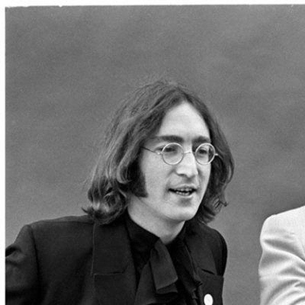
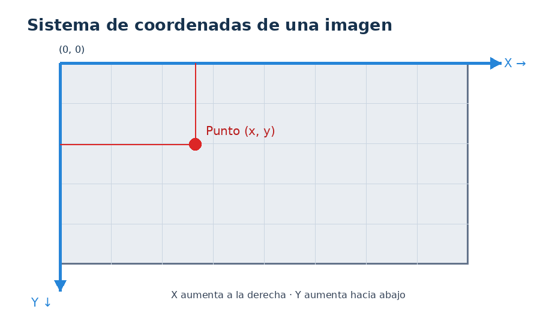

# Práctica: Dibujo de puntos, rectángulos y círculos sobre una imagen con OpenCV

> **Nivel:** Cero a principiante  
> **Duración sugerida:** 2 horas  
> **Asignatura:** Soluciona problemas de Visión Artificial  
> **Especialidad:** Inteligencia Artificial  
> **Semestre:** Tercer semestre de preparatoria  
> **Herramientas:** Python, Visual Studio Code y OpenCV.

## 1. Propósito de la práctica

Que los estudiantes aprendan a utilizar OpenCV para realizar operaciones básicas sobre una imagen digital:

1. Leer una imagen en blanco y negro.
2. Mostrar la imagen y consultar sus dimensiones.
3. Colocar un título sobre la imagen y guardarla.
4. Colocar puntos rojos en coordenadas `(x, y)`, mostrar y guardar.
5. Dibujar un rectángulo sobre la imagen, mostrar y guardar.
6. Dibujar un círculo sobre la imagen, mostrar y guardar.

**Imagen de trabajo:** utilizaremos la fotografía proporcionada `JohnLennon.jpg`, que tiene dimensiones de **600 × 600 píxeles** y está en escala de grises.



## 2. Crear la carpeta de trabajo desde VS Code

### Paso 1. Abrir Visual Studio Code

1. Abre Visual Studio Code.
2. Selecciona el menú **Terminal → New Terminal**.
3. Comprueba que estás utilizando PowerShell.

### Paso 2. Crear la carpeta del proyecto

Escribe los siguientes comandos:

```powershell
mkdir u3-puntos-img-0777
cd u3-puntos-img-0777
```

**Explicación:**

- `mkdir`: crea una carpeta.
- `cd`: permite ingresar a la carpeta.

### Paso 3. Crear el entorno virtual

```powershell
python -m venv .env-va-0777
```

El entorno virtual permite instalar las librerías necesarias para el proyecto sin modificar otros entornos de Python.

### Paso 4. Activar el entorno virtual

```powershell
.\.env-va-0777\Scripts\Activate.ps1
```

Si PowerShell no permite activar el entorno, ejecuta:

```powershell
Set-ExecutionPolicy -Scope Process -ExecutionPolicy Bypass
```

Después vuelve a activar el entorno.

La terminal deberá mostrar algo parecido a:

```text
(.env-va-0777) PS C:\...\u3-puntos-img-0777>
```

### Paso 5. Instalar OpenCV y NumPy

```powershell
python -m pip install --upgrade pip
pip install opencv-python numpy
```

| Librería | Función |
|---|---|
| `opencv-python` | Permite leer, mostrar, modificar y guardar imágenes. |
| `numpy` | Permite trabajar con matrices y datos numéricos de las imágenes. |

### Paso 6. Crear el archivo de requerimientos

```powershell
pip freeze > requirements.txt
```

Este archivo guarda las librerías instaladas y sus versiones.

Para consultar su contenido:

```powershell
Get-Content requirements.txt
```

## 3. Crear la estructura de carpetas y archivos

Ejecuta estos comandos:

```powershell
mkdir img-original-0777
mkdir codigopy-0777
mkdir resultados-img-0777
```

La estructura del proyecto quedará de la siguiente manera:

```text
u3-puntos-img-0777/
│
├── .env-va-0777/
│
├── img-original-0777/
│   └── JohnLennon.jpg
│
├── codigopy-0777/
│   └── p1-puntos-img-0777.py
│
├── resultados-img-0777/
│
└── requirements.txt
```

**Importante:** copia la fotografía proporcionada dentro de la carpeta `img-original-0777` y conserva exactamente el nombre `JohnLennon.jpg`.

### Paso 7. Crear el archivo Python

Dentro de la carpeta `codigopy-0777`, crea el archivo:

```text
p1-puntos-img-0777.py
```

En VS Code, selecciona el intérprete del entorno virtual:

1. Presiona `Ctrl + Shift + P`.
2. Escribe `Python: Select Interpreter`.
3. Selecciona el intérprete `.env-va-0777`.

---

## 4. Código completo de la práctica

Copia el siguiente código dentro de `p1-puntos-img-0777.py`.

El programa realiza seis operaciones y guarda automáticamente cada resultado en `resultados-img-0777`.

```python
# ==========================================================
# PRACTICA 1: PUNTOS, RECTANGULOS Y CIRCULOS CON OPENCV
# Especialidad: Inteligencia Artificial
# Archivo: p1-puntos-img-0777.py
# ==========================================================

import cv2
import os

# ----------------------------------------------------------
# 1. DEFINIR LAS RUTAS DE LAS CARPETAS Y LA IMAGEN
# ----------------------------------------------------------

carpeta_imagenes = "img-original-0777"
carpeta_resultados = "resultados-img-0777"

ruta_imagen = os.path.join(carpeta_imagenes, "JohnLennon.jpg")

# Crear la carpeta de resultados si no existe
os.makedirs(carpeta_resultados, exist_ok=True)

# ----------------------------------------------------------
# 2. LEER LA IMAGEN EN BLANCO Y NEGRO
# ----------------------------------------------------------

imagen = cv2.imread(ruta_imagen, cv2.IMREAD_GRAYSCALE)

# Comprobar que la imagen se haya leído correctamente
if imagen is None:
    raise FileNotFoundError(
        "No se encontro JohnLennon.jpg en img-original-0777"
    )

print("IMAGEN CARGADA CORRECTAMENTE")

# ----------------------------------------------------------
# 3. CONSULTAR LAS DIMENSIONES DE LA IMAGEN
# ----------------------------------------------------------

alto, ancho = imagen.shape

print("Alto:", alto, "pixeles")
print("Ancho:", ancho, "pixeles")
print("Dimensiones:", ancho, "x", alto)

# Mostrar la imagen original en blanco y negro
cv2.imshow("01 - Imagen original en blanco y negro", imagen)
cv2.imwrite(
    os.path.join(carpeta_resultados, "01_imagen_original.jpg"),
    imagen
)
cv2.waitKey(0)

# ----------------------------------------------------------
# 4. CONVERTIR LA IMAGEN A COLOR PARA DIBUJAR EN ROJO
# ----------------------------------------------------------

imagen_color = cv2.cvtColor(imagen, cv2.COLOR_GRAY2BGR)

# ----------------------------------------------------------
# 5. COLOCAR UN TITULO SOBRE LA IMAGEN
# ----------------------------------------------------------

imagen_titulo = imagen_color.copy()

cv2.putText(
    imagen_titulo,
    "PRACTICA DE VISION ARTIFICIAL",
    (20, 40),
    cv2.FONT_HERSHEY_SIMPLEX,
    0.65,
    (0, 0, 255),
    2
)

cv2.imshow("02 - Imagen con titulo", imagen_titulo)
cv2.imwrite(
    os.path.join(carpeta_resultados, "02_imagen_titulo.jpg"),
    imagen_titulo
)
cv2.waitKey(0)

# ----------------------------------------------------------
# 6. COLOCAR PUNTOS ROJOS EN COORDENADAS X,Y
# ----------------------------------------------------------

imagen_puntos = imagen_color.copy()

# Coordenadas de los puntos: (x, y)
puntos = [
    (100, 100),
    (200, 200),
    (300, 300),
    (400, 400)
]

for x, y in puntos:

    cv2.circle(
        imagen_puntos,
        (x, y),
        7,
        (0, 0, 255),
        -1
    )

    print("Punto colocado en:", x, y)

cv2.imshow("03 - Imagen con puntos rojos", imagen_puntos)
cv2.imwrite(
    os.path.join(carpeta_resultados, "03_imagen_puntos.jpg"),
    imagen_puntos
)
cv2.waitKey(0)

# ----------------------------------------------------------
# 7. DIBUJAR UN RECTANGULO
# ----------------------------------------------------------

imagen_rectangulo = imagen_color.copy()

# Coordenada inicial y coordenada final
punto_inicial = (100, 120)
punto_final = (350, 400)

cv2.rectangle(
    imagen_rectangulo,
    punto_inicial,
    punto_final,
    (0, 0, 255),
    3
)

cv2.imshow("04 - Imagen con rectangulo rojo", imagen_rectangulo)
cv2.imwrite(
    os.path.join(carpeta_resultados, "04_imagen_rectangulo.jpg"),
    imagen_rectangulo
)
cv2.waitKey(0)

# ----------------------------------------------------------
# 8. DIBUJAR UN CIRCULO
# ----------------------------------------------------------

imagen_circulo = imagen_color.copy()

# Centro del circulo y radio
centro = (430, 300)
radio = 70

cv2.circle(
    imagen_circulo,
    centro,
    radio,
    (0, 0, 255),
    3
)

cv2.imshow("05 - Imagen con circulo rojo", imagen_circulo)
cv2.imwrite(
    os.path.join(carpeta_resultados, "05_imagen_circulo.jpg"),
    imagen_circulo
)
cv2.waitKey(0)

# ----------------------------------------------------------
# 9. CERRAR TODAS LAS VENTANAS
# ----------------------------------------------------------

cv2.destroyAllWindows()

print("-------------------------------------")
print("PRACTICA TERMINADA CORRECTAMENTE")
print("Revisa la carpeta resultados-img-0777")
print("-------------------------------------")
```

---

## 5. Explicación breve paso a paso

### Ejemplo 1. Leer una imagen en blanco y negro

```python
imagen = cv2.imread(ruta_imagen, cv2.IMREAD_GRAYSCALE)
```

- `cv2.imread()`: permite leer una imagen desde el disco.
- `ruta_imagen`: indica dónde se encuentra el archivo.
- `cv2.IMREAD_GRAYSCALE`: lee la imagen en escala de grises.

Para mostrarla:

```python
cv2.imshow("Imagen original", imagen)
```

- Primer parámetro: nombre de la ventana.
- Segundo parámetro: imagen que se desea mostrar.

Para consultar sus dimensiones:

```python
alto, ancho = imagen.shape
```

- `alto`: cantidad de píxeles verticales.
- `ancho`: cantidad de píxeles horizontales.

**Dimensiones de la fotografía proporcionada:**

| Dimensión | Valor |
|---|---:|
| Alto | 600 píxeles |
| Ancho | 600 píxeles |

### Ejemplo 2. Colocar un título

```python
cv2.putText(
    imagen_titulo,
    "PRACTICA DE VISION ARTIFICIAL",
    (20, 40),
    cv2.FONT_HERSHEY_SIMPLEX,
    0.65,
    (0, 0, 255),
    2
)
```

| Parámetro | Explicación |
|---|---|
| `imagen_titulo` | Imagen donde se escribirá el título. |
| `"PRACTICA DE VISION ARTIFICIAL"` | Texto que aparecerá. |
| `(20, 40)` | Coordenadas donde comienza el texto. |
| `cv2.FONT_HERSHEY_SIMPLEX` | Tipo de letra. |
| `0.65` | Tamaño de letra. |
| `(0, 0, 255)` | Color rojo en formato BGR. |
| `2` | Grosor de las letras. |

### Ejemplo 3. Colocar puntos rojos

```python
cv2.circle(imagen_puntos, (100, 100), 7, (0, 0, 255), -1)
```

Aunque se utiliza `cv2.circle()`, un círculo pequeño y relleno funciona como un punto.

| Parámetro | Explicación |
|---|---|
| `imagen_puntos` | Imagen donde se colocará el punto. |
| `(100, 100)` | Coordenadas X, Y. |
| `7` | Radio del punto. |
| `(0, 0, 255)` | Color rojo. |
| `-1` | Rellenar completamente el círculo. |

**¿Cómo funcionan las coordenadas?**



El origen `(0, 0)` se encuentra en la esquina superior izquierda. X aumenta hacia la derecha y Y hacia abajo.

### Ejemplo 4. Dibujar un rectángulo

```python
cv2.rectangle(
    imagen_rectangulo,
    (100, 120),
    (350, 400),
    (0, 0, 255),
    3
)
```

| Parámetro | Explicación |
|---|---|
| `imagen_rectangulo` | Imagen donde se dibujará. |
| `(100, 120)` | Esquina superior izquierda. |
| `(350, 400)` | Esquina inferior derecha. |
| `(0, 0, 255)` | Color rojo. |
| `3` | Grosor del borde en píxeles. |

### Ejemplo 5. Dibujar un círculo

```python
cv2.circle(
    imagen_circulo,
    (430, 300),
    70,
    (0, 0, 255),
    3
)
```

| Parámetro | Explicación |
|---|---|
| `imagen_circulo` | Imagen donde se dibujará. |
| `(430, 300)` | Coordenadas del centro. |
| `70` | Radio del círculo. |
| `(0, 0, 255)` | Color rojo. |
| `3` | Grosor del borde. |

### Ejemplo 6. Guardar las imágenes

```python
cv2.imwrite("resultados-img-0777/05_imagen_circulo.jpg", imagen_circulo)
```

- `cv2.imwrite()`: guarda una imagen.
- Primer parámetro: ruta y nombre del archivo.
- Segundo parámetro: imagen que se guardará.

**Nota importante sobre los colores:** OpenCV utiliza el orden BGR (azul, verde, rojo), no RGB. Por eso `(0, 0, 255)` representa rojo. Como la imagen original está en escala de grises, el programa la convierte a BGR antes de dibujar los elementos rojos.

---

## 6. Ejecutar el programa

Desde la terminal de VS Code, asegúrate de estar dentro de `u3-puntos-img-0777` y ejecuta:

```powershell
python .\codigopy-0777\p1-puntos-img-0777.py
```

Se abrirán las ventanas de resultados una por una. Presiona cualquier tecla para cerrar la ventana actual y continuar con la siguiente.

## 7. Resultados generados automáticamente

Al terminar, encontrarás los siguientes archivos:

```text
resultados-img-0777/
│
├── 01_imagen_original.jpg
├── 02_imagen_titulo.jpg
├── 03_imagen_puntos.jpg
├── 04_imagen_rectangulo.jpg
└── 05_imagen_circulo.jpg
```

| Archivo | Resultado esperado |
|---|---|
| `01_imagen_original.jpg` | Fotografía en blanco y negro. |
| `02_imagen_titulo.jpg` | Fotografía con título en la parte superior. |
| `03_imagen_puntos.jpg` | Fotografía con cuatro puntos rojos. |
| `04_imagen_rectangulo.jpg` | Fotografía con rectángulo rojo. |
| `05_imagen_circulo.jpg` | Fotografía con círculo rojo. |

## 8. Problemas frecuentes y soluciones

| Problema | Solución |
|---|---|
| `No module named cv2` | Ejecutar `pip install opencv-python`. |
| No se encuentra la imagen | Comprobar que `JohnLennon.jpg` esté en `img-original-0777`. |
| No aparece la ventana | Ejecutar el programa desde la terminal de VS Code, no desde un entorno sin interfaz gráfica. |
| No se guardan los resultados | Comprobar que se ejecuta el programa desde la carpeta principal del proyecto. |
| Los puntos no aparecen rojos | Verificar que se realizó la conversión con `cv2.COLOR_GRAY2BGR`. |

## 9. Actividad de reforzamiento para el estudiante

Realiza las siguientes modificaciones en el código:

1. Agrega dos puntos rojos en otras coordenadas.
2. Cambia el título por tu nombre.
3. Modifica el tamaño del rectángulo.
4. Cambia el radio del círculo de `70` a `100`.
5. Guarda los resultados con nombres diferentes.

**Preguntas de evaluación:**

1. ¿Qué función de OpenCV permite leer una imagen?
2. ¿Qué significa `cv2.IMREAD_GRAYSCALE`?
3. ¿Cómo se obtienen el alto y ancho de una imagen?
4. ¿Qué función permite escribir un título sobre una imagen?
5. ¿Cómo se representa un punto mediante coordenadas `(x, y)`?
6. ¿Qué diferencia existe entre `cv2.rectangle()` y `cv2.circle()`?
7. ¿Qué función permite guardar una imagen procesada?

## 10. Distribución sugerida de las 2 horas

| Actividad | Tiempo |
|---|---:|
| Explicación de imágenes y coordenadas | 15 min |
| Crear carpeta, entorno virtual e instalar librerías | 20 min |
| Leer, mostrar y consultar dimensiones | 15 min |
| Colocar título y guardar | 15 min |
| Dibujar puntos rojos | 20 min |
| Dibujar rectángulo y círculo | 20 min |
| Ejecutar, modificar y revisar resultados | 15 min |
| **Total** | **120 min** |

**Evidencia de aprendizaje:** entregar la carpeta del proyecto con el archivo Python, `requirements.txt` y las cinco imágenes procesadas.

**Resultado esperado:** el estudiante comprende cómo leer, visualizar, modificar y guardar imágenes digitales utilizando las funciones básicas de OpenCV en Python.
